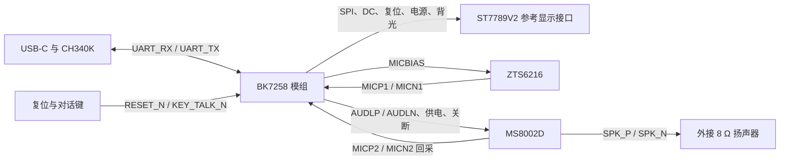
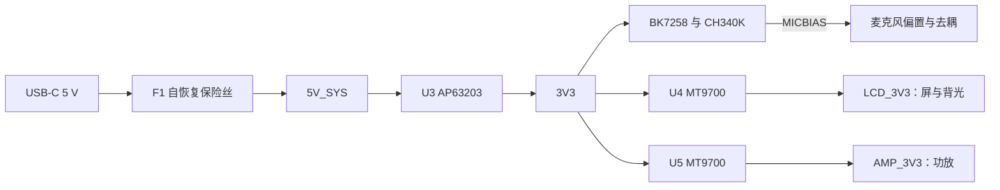

# 桌灵 · DeskSprite 第一版原理图

> 当前 GPIO 优化（2026-11-14）：只读参考用户当前 PCB，将屏幕电源/复位/DC/背光改为 P25/P1/P28/P9（PWM3），音频电源/关断改为 P15/P14。控制线相关直线交点从 44 降至 10，仅为规划指标。62 个实体器件、51 个网络不变，原生检查无新增问题且独立审计通过。PCB 未修改，需用户自行同步原理图变化。当前以 [最新引脚规划](../design/pin-plan/20261114/review.md) 为准，下方 P6/P7/P5/P25 等较早分配属于历史。

> 最新无按键版（2026-11-14，V0.3）：已删除 SW1/SW2、C11/C12、R5；CEN 与 P28 无外部连接，下载复位可断电重上电完成。65 脚已从混用的 VIO 名称更正为 VDDGPIO，C10 实际器件绑定改为 1 µF。当前为 62 个实体器件、51 个网络；原生网表与独立审计通过，ERC 无新增问题。当前状态以 [无按键版记录](../design/remove-buttons/20261114/review.md) 为准；下方早期器件数量、按键电路、VIO/4.7 µF 描述均属历史。

> 当前原理图 GPIO 更新（2026-11-14）：为便于用户自行布线，将屏复位从内部 P12 改为外圈 P6（模组 23 脚），屏电源使能从内部 P13 改为外圈 P7（模组 22 脚）。原理图与说明已同步，PCB 由用户处理，本次未向正式 PCB 应用修改。详情见 [GPIO 调整记录](../design/schematic-gpio-remap/20261114/review.md)。

> 当前显示接口更新（2026-11-14，V0.2）：用户选定 D200N2407V0 无触摸屏，屏体 34.6×47.8×1.9 mm。J2 已按该屏 1=LEDK、2=LEDA、4=VCC 的定义重新连接，原生网表及独立复核通过。最新 ERC 只有 B1–B4 四条虚拟模块无封装提示。背光电流及 R9 阻值仍待实测确认。当前线序、尺寸图与验证证据以 [屏幕适配记录](../design/display-selection/screen-selection.md) 为准；下方是 V0.1 历史设计，旧线序不再用于本屏。

> 复核更正（2026-11-14）：初版五类跨网端点接触曾被网表/ERC 漏检。用户修正后的 17:32 版本未再发现电气网络错配，尚有 USB 页两条栅格警告及四条总览虚拟模块无封装提示。以下为初版历史记录，当前状态请以 [最新复核报告](../design/reviews/20261114173243/review.md) 为准。

2026-11-14，V0.1。可编辑工程为本目录的 `桌灵 · DeskSprite.eprj3`，图页及必要符号、封装、器件与模型引用保存在 `sch/Schematic1/`。本次完成原理图设计和检查，未进行 PCB 或实物验证。

## 功能与图页

通过 USB-C 供电及串口烧录，以 BK7258 模组实现 Wi-Fi 桌面终端，预留显示、采音、扬声器和对话按键。当前没有采购确定的屏幕总成。

| 页 | 内容 | 原生导出预览 |
| --- | --- | --- |
| 01 系统接口总览 | 四个带实际电气引脚的模块，关联功能页网络 | [总览](../design/preview/page-1.png) |
| 02 USB与电源 | USB-C/保护、CH340K、AP63203 3.3 V 降压 | [电源](../design/preview/page-2.png) |
| 03 主控与按键 | BK7258 模组两个符号单元、去耦、复位、对话键 | [主控](../design/preview/page-3.png) |
| 04 显示接口 | 屏电源开关、10 针 FPC、低有效背光 | [显示](../design/preview/page-4.png) |
| 05 采音与播放 | ZTS6216 麦克风、音频电源、MS8002D 与 ADC2 回采 | [音频](../design/preview/page-5.png) |

图页采用全局网络关联的平面分页，模块内部使用实际电气导线。总览 B1–B4 为虚拟电气对象，属性已设置不进入 BOM、不转入 PCB；并非真实层次子图页实例。当前客户端将它们导出为灰色网纹，外部中文标题、端口和网络名可见。

中文独立说明共 45 条，默认字体，100 mil（文件单位 10 mil，fontSize=10）。符号字段和网络名沿用工程字号。五张原生导出图均已检查。

## 主要器件与 BOM

完整料号、立创编号、数值、封装和模型标题见 [BOM.csv](../design/BOM.csv)。共 67 个实体器件；U1 两个符号单元只计算一颗模组，虚拟模块与电源符号不计入。

| 位号 | 器件 | 用途 |
| --- | --- | --- |
| U1 | LC-OPEN-BK7258-MOD / C55863540 | 主控、Wi-Fi、音频 ADC/DAC |
| U2 | CH340K / C968586 | USB 转串口，手动复位烧录 |
| U3 | AP63203WU-7 / C780769 | 5 V→3.3 V，芯片额定 2 A |
| U4、U5 | MT9700-N / C42441843 | 屏与功放电源开关 |
| U6 | MS8002D / C42403122 | 3.3 V 差分功放 |
| MIC1 | ZTS6216 / C481302 | 模拟麦克风 |
| J2 | AFC34-S10FIA-00 / C2842524 | 10 针、0.5 mm FPC |
| Q1 | AO3401A / C15127 | 背光高边开关，控制低有效 |
| D1 | USBLC6-2SC6 / C7519 | USB 数据线 ESD 保护 |

67/67 个实体器件具有封装和 3D 模型引用。符号引脚到封装焊盘编号逐项检查无缺失；采用真实器件库的模型 UUID、标题及变换参数，未下载并逐一测量 67 个模型的几何尺寸，故不将绑定覆盖率等同于机械匹配认证。详见 [绑定清单](../design/evidence/component-bindings.json)。

电阻、电容通常采用 0603 英制。C6/C7 使用 0805 / 25 V，以保留有效容量；C16 使用 1206 的 C0G 100 nF，满足麦克风近端避免 Class 2 介质的要求。L1 选用 4.7 µH，计算和原厂允许范围见 [设计依据](../design/design-intent.md)。没有声称当前价格或库存已经核实。

## 信号框架

## 电源框架

USB 受电端没有 PD 协商和 CC 电流档位检测。2 A 是降压芯片能力，不代表电脑 USB 口已允许取用 2 A。应按实测整机峰值与所用 USB 电源能力确认供电方案。F1 保持电流 1.5 A；MT9700 的 6.8 kΩ 对应典型约 1 A 限流，手册范围 0.75–1.25 A。

## 显示接口与网络

官方文档使用 **ST7789V2、240×320、RGB565 的 SPI 屏**。[立创 SPI 与显示文档](https://wiki.lckfb.com/zh-hans/bk7258md/basic/spi.html) 没有给出可据此直接采购的完整屏幕总成料号。当前原理图按仓库官方参考 PDF 第 5 页的 FPC 接口设计，屏幕尺寸、品牌和接触方向均未假定。

| J2 引脚 | 信号 | BK7258 GPIO |
| --- | --- | --- |
| 1 | LCD_DC | P5 |
| 2 | LCD_MOSI | P4 |
| 3 | LCD_CS_N | P3 |
| 4 | LCD_RST_N | P12 |
| 5 | LCD_SCK | P2 |
| 6、8、10 | GND / BLK | — |
| 7 | LCD_3V3 | 经 U4 供电，P13 使能 |
| 9 | BLA | 经 Q1、10 Ω 电阻；P25 低有效 |
| 11、12 | 固定焊脚 GND | — |

本接口的引脚 1 是 DC，官方参考图上的 `LCD_MISO` 名称不代表屏幕需要 MISO。背光 10 Ω 为参考取值，须按最终屏的电流要求复核，不能仅凭 ST7789 驱动型号直接插接。

共 53 个网络、67 个实体器件、260 个实体引脚，其中 209 个有连接、51 个明确标为未连接；加上总览模块后，导出为 71 个器件、304 个引脚、253 个有连接引脚。UART 名称以主控方向定义，CH340K TX 经 100 Ω 接 P10/RXD，P11/TXD 经 100 Ω 接 CH340K RX。

## 验证与证据

| 检查 | 结果 |
| --- | --- |
| 原生 ERC：四个功能页 | fatalError=0、error=0、warn=0；[结果](../design/evidence/erc-functional-pages.json) |
| 原生 ERC：完整五页 | fatalError=4、error=0、warn=0；四条均为 B1–B4 的 MISSFOOTPRINT；[结果](../design/evidence/erc-final.json) |
| 电气网表与设计映射 | 253 个已连接引脚逐项匹配；53 个网络；[最终网表](../design/evidence/netlist-final.json) |
| 独立网表审计 | 全新独立审计实例读取实际导出网表及原厂资料，未发现阻断性电气连线错误；[审计报告](../design/evidence/independent-netlist-audit.md) |
| 引脚—焊盘、绑定、字体及布线检查 | 无映射缺项、无路由失败；[综合结果](../design/evidence/verification.json) |
| 官方工程结构检查 | 0 错误；1 条未创建可选 Schematic1.evar 的提示；[结果](../design/evidence/format-project.json) |
| 原始记录 JSON Schema 检查 | 1461 条记录与校验器要求存在字段差异，未宣称通过；说明如下 |
| 保存校验 | 五页与经过上述检查的暂存文件逐字节一致；[交付记录](../design/evidence/delivery.json) |

完整原理图的 ERC **没有全绿**：B1–B4 是不装配的虚拟电气模块，因此没有添加虚假封装，也没有关闭无封装规则。四个功能页单独进行原生 ERC，零错误、零警告。

本机 CLI 内核为 4.1.71，新版官方 skill 所需的 sch_Source 接口不可用。本次采用已存在的 Document/库接口与官方文件格式完成原理图，未修改 EDA 客户端安装。原始 JSON Schema 对 ATTR 默认字段、null 继承值以及 NO_CONNECT 的部分字段覆盖要求与客户端实际保存格式不一致；作为对照，用户原始未编辑空白页的 33 条主图元也全部出现相同类别的 Schema 差异。保留原生继承字段并分别报告结构检查和原生 ERC，未为清零校验结果而随意改写这些字段。详见 [兼容性记录](../design/evidence/schema-compatibility.json)。

最终网表 SHA-256：`af7f4645cdf08010b5c4249f0b3212d4a98f1e8359d0659239ad9521e2c7a7f9`。它与独立审计确认的最终版本相同；图面整理没有改变实体针脚或网络分组。

## 尚需确认

1. 屏幕完整料号、FPC 接触面与引脚顺序、背光电流，再定 R9 等实际取值。
2. USB 电源可用电流、整机峰值与启动瞬态、3.3 V 纹波和电感/保险丝温升。
3. 实际模组版本的 VDDGPIO/VIO 定义；本设计该脚仅去耦，没有接外部 3.3 V。
4. 麦克风偏置、功放增益、ADC2 回采幅度、声学效果。3.3 V 下未声称输出 2.8 W；扬声器按 8 Ω、额定至少 1 W 预留，两端均不可接地。
5. 固件采用本工程 GPIO：PTT=P28；屏电源=P13、背光=P25；音频电源=P8、SD=P23。音频关断顺序为 SD 高→控制 GPIO 无上下拉高阻→关闭功放电源；屏断电前将相关 GPIO 置低或高阻。
6. 模型引用的实际几何匹配与装配方向仍需在选定实物后核实。

## 文件与依据

原工程的索引、空白 P1 和原理图配置已备份到 `../design/backups/2026-11-14-before-schematic/`。原有 PCB/拼板索引和原理图配置保留；没有打开、读取、生成或修改 PCB 板文件。

设计来源、原厂版本/页码及选型例外见 [design-intent.md](../design/design-intent.md)，AI 工作记录见 [ai-report.md](ai-report.md)。生成、布线与验证脚本及必要嵌入库缓存保留在 `../design/`，实际交付不依赖临时目录才能打开。
