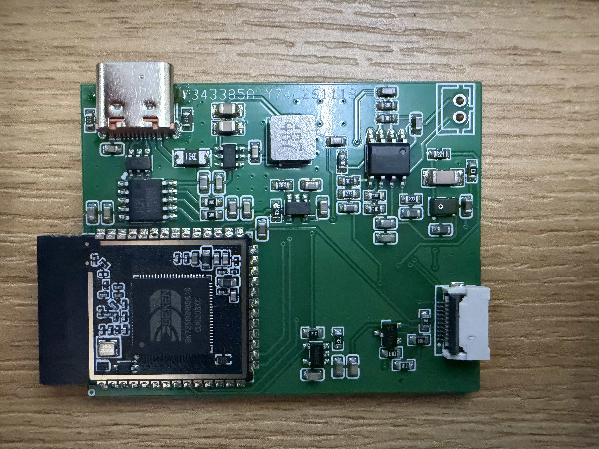

# 桌灵 DeskSprite

桌灵是基于 BK7258 的 Windows 桌面语音控制终端。自制主板通过 USB-C 接入电脑，板载麦克风采集语音，Windows 上位机完成本机中文指令识别、语音播报和电脑操作。

**项目已于 2026-11-23 结项。** 当前交付使用 Windows 状态面板，支持查询 CPU、内存、网速和进程，控制音量和媒体，打开预设应用及项目，并启动专注计时。实体 LCD 在联调中未点亮，留作硬件诊断。

## 快速使用

1. 在 Windows 11 安装 uv，从仓库根目录运行 `uv run --directory Desktop --locked python app.py`，也可以双击 `Desktop/start.cmd`。
2. 面板地址为 `http://127.0.0.1:8765`。可输入「现在内存用了多少」，也可点击「电脑麦克风」说出指令。
3. 使用板载麦克风时，先按[固件说明](Firmware/voice-bringup/README.md)构建和烧录，再在 `Desktop/settings.json` 中填写实际 COM 号。

## 交付资料

| 内容 | 入口 |
| --- | --- |
| 项目介绍、实物和上位机照片 | [项目说明](docs/桌灵DeskSprite项目描述.md) · [Word 版](docs/桌灵DeskSprite项目描述.docx) |
| 结项范围和验证记录 | [项目方案与结项记录](docs/PROJECT_PLAN.md) · [决策记录](docs/DECISIONS.md) |
| 上位机配置及常用指令 | [Windows 上位机](Desktop/README.md) |
| 板端构建、烧录和串口协议 | [BK7258 固件](Firmware/voice-bringup/README.md) |
| 原理图、PCB、BOM 与屏幕接口 | [硬件归档](Hardware/README.md) |
| 官方参考资料及历史提交 | [资料索引](docs/SOURCES.md) |
| 立创开源硬件平台 | [桌灵 DeskSprite 工程](https://oshwhub.com/smallcoral/project_fwqytqsw) |
