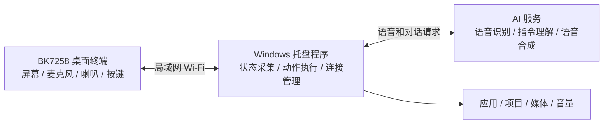

# BK7258

基于立创 BK7258 的电脑联动 AI 桌面助手。

目标是做一个放在显示器旁的“电脑状态屏＋语音控制器”：BK7258 负责屏幕、按键、采音与播放；Windows 托盘程序读取电脑状态、执行预设动作并连接 AI 服务。

**当前阶段：资料归档与方案设计。尚未购买硬件，尚无本项目自行实现的助手固件或电脑端程序。**

## 当前方向

用户已确认：

- 还没购买 BK7258 硬件。
- 最看重与电脑联动，显示状态和执行指令。
- 以私有 GitHub 仓库保存本项目、对话及方案。

第一版计划包括 CPU/内存/网速面板、语音查询、音量与媒体控制、打开指定应用和项目，以及可配置的工作模式。表情、时钟和计时作为辅助界面。



## 文档入口

| 文档 | 内容 |
|---|---|
| [当前方案](docs/PROJECT_PLAN.md) | 用户确认偏好后的方案、采购规格、开发顺序与待执行验收项 |
| [决策与待定项](docs/DECISIONS.md) | 已确认需求、工程建议、尚未验证的适配事项 |
| [完整可见对话](docs/conversations/2026-11-13.md) | 7 轮对话的用户消息、助手过程说明、澄清问题和正式答复 |
| [对话 JSON](docs/conversations/2026-11-13.json) | 原始可见消息正文及标识，供后续导入或整理 |
| [资料索引](docs/SOURCES.md) | 原始附件、官方文档与候选开源项目 |
| [文件校验清单](docs/FILE_MANIFEST.json) | 原始项目资料和手台附件的大小与 SHA-256 |
| [模组能力调研](docs/research/module-capabilities.md) | 模组资源、外设能力及使用边界 |
| [初始桌面方案](docs/plans/2026-11-13-initial-desktop-assistant.md) | 偏好确认前的语音对话、时钟、番茄钟方案，保留历史 |
| [无线电方向调研](docs/research/amateur-radio-feasibility.md) | 已停止推进的早期方向 |
| [UV-K1 功能对照](docs/research/uv-k1-comparison.md) | 手台资料分析与历史可行性判断 |

## 仓库结构

```text
Document/
  立创·实战派BK7258/    原有烧录工具、示例压缩包、原理图和寄存器表
  参考资料/UV-K1/       本次对话提供的手台说明书、固件及写频软件压缩包
Firmware/              未来设备固件的位置，当前只有状态说明
Hardware/              未来底板与外壳设计的位置，当前只有状态说明
docs/                  方案、决策、对话和研究记录
```

## 现有代码与开发准备

原始 `demo.zip` 包含 20 个示例工程、422 个文件，覆盖 GPIO、ADC、UART、I²C、按键、存储、Wi-Fi、蓝牙音频、摄像头、LCD、触摸、LVGL 和音乐播放。它们是参考资料，尚未在本项目上完成编译或板上验证。

示例依赖完整的 `bk_avdk_smp_sdk` 和公共 `components`、`cmake`、构建脚本；当前资料包没有包含这些依赖，因此此仓库暂不能直接构建成品固件。开发环境按官方教程准备，参考 SDK 版本为 `release/v3.1.1.9`，实际接入时固定匹配版本。

推荐顺序：先用网页模拟终端验证 Windows 状态采集与动作，再采购配套硬件并联调 BK7258，最后验证稳定性和外壳。当前没有测试过的采购清单、云服务费用或整机性能承诺。

## 归档范围

2026-11-13 归档原有 6 个资料文件、用户提供的 3 个手台附件以及对话和方案。原始压缩包保持原样；所有资料使用范围及权利归原作者。对话保留至用户提出 GitHub 归档请求，工具原始输出、内部推理和系统配置不属于对话正文。
