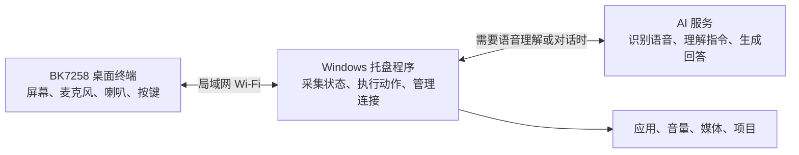

# BK7258 电脑联动桌面助手方案

> 状态：方案阶段，尚未开始应用实现或硬件采购。
> 用户已确认：还没购买硬件；最看重“与电脑联动，显示状态和执行指令”。
> 下文是确认偏好后形成的最新方案；取代以聊天、番茄钟为主的初始方案。开发顺序为电脑端原型、硬件联调、稳定性与外壳。
> 本次工作仅归档项目、对话和方案，没有安装 SDK、购买硬件或实现以下功能。

那就把第一版定位为：**放在显示器旁的“电脑状态屏＋语音控制器”**。按你目前的环境，以 Windows 为目标，BK7258 做桌面终端，电脑端程序负责读取状态、执行操作和连接 AI。

相比上一版，开发重点调整到电脑联动，表情、时钟作为辅助界面。

第一版建议实现这些：

| 功能 | 你实际能做什么 |
|---|---|
| 电脑状态面板 | 查看 CPU、内存占用、网络上下行速度 |
| 语音查询 | 问“现在内存用了多少”“哪个程序占用最高” |
| 音量与媒体控制 | 说“音量调到30%”“暂停播放” |
| 打开应用和项目 | 说“打开 VS Code”“打开 BK7258 项目” |
| 工作模式 | 一句话打开预先配置的应用组合，并启动专注计时 |
| 执行结果反馈 | 屏幕显示成功或失败，助手根据实际结果回答 |

CPU 温度、显卡监控、构建完成提醒放到第二阶段：前两项按电脑硬件适配，构建状态由开发工具主动上报。

整体结构改成这样：

**电脑端程序是这个方案的核心。** 它运行在当前登录用户下，才能方便地控制桌面应用和媒体。状态数据每隔约1～2秒直接推送到小屏；语音指令经过理解后，调用“打开指定应用”“设置音量”等预先定义的动作，执行成功后再反馈。

软件建议这样搭配：

- **设备端：** BK7258 官方 SDK＋LVGL，复用小智参考工程的音频与通信能力，增加电脑状态页面。
- **电脑端：** Python 托盘程序＋WebSocket 通信；用 `psutil` 采集 CPU、内存、网络和进程信息，再通过 Windows 接口执行桌面操作。相关监控能力已有成熟库支持。[psutil 官方文档](https://psutil.io/)
- **语音服务：** 优先复用小智协议兼容的服务端，再接电脑工具。开源候选已有 WebSocket、语音处理和 MCP 支持；与 BK7258 固件的握手、音频格式和工具调用仍需联调验证。[服务端项目](https://github.com/xinnan-tech/xiaozhi-esp32-server)

连接方式先选 **USB 供电和烧录＋Wi-Fi 传数据**。电脑与设备在同一个局域网内配对，模型密钥保存在电脑端。电脑休眠或程序退出后，屏幕显示“电脑未连接”；本地时钟、已启动的计时仍可继续。

既然你还没买硬件，采购优先考虑**带配套源码和原理图的完整 BK7258 开发套件**：

| 部件 | 第一版要求 |
|---|---|
| 主板 | BK7258＋已焊好的供电、烧录、音频电路 |
| 屏幕 | 优先选现有示例支持的 ST7789V2，240×320，横屏使用 |
| 音频 | 配套麦克风、功放和喇叭 |
| 交互 | 至少一个按键，用于开始说话和打断 |
| 供电 | USB 常供电 |

屏幕型号、排线和板端接口要配套。你资料中的扩展板目前还没有核实到具体在售套装，因此这份是**采购规格清单**，还不是已确认的商品清单。若购买裸模组，还需要另外解决底板、供电和烧录连接。[官方硬件指南](https://wiki.lckfb.com/zh-hans/bk7258md/bk7258-mod/hardware.html)

开发顺序也可以利用“还没买硬件”这个条件：

1. **先做电脑端原型。** 用网页模拟桌面小屏，跑通状态显示、音量控制、打开应用和执行结果反馈；语音先用电脑现有麦克风验证。
2. **再接 BK7258 实物。** 完成屏幕、音频和局域网通信，把网页中验证过的功能移到小屏上。
3. **最后完善桌面体验。** 加表情、按键打断、自动重连和外壳，并验证重复指令不会重复启动任务。

第一版最有代表性的体验是：**你说“进入工作模式”，电脑打开配置好的项目和应用，小屏开始专注计时，同时显示电脑负载。** 这会比单纯聊天更贴合你想要的电脑助手。

## 联调验收记录（待执行）

- [ ] 网页模拟终端正确显示电脑状态，并标明更新时间。
- [ ] 读取 CPU、内存、网速及占用最高的进程，与电脑侧采集结果一致。
- [ ] 调整音量、控制播放、打开预设应用或项目后返回实际执行结果。
- [ ] “工作模式”的应用组合可配置，重复请求不会重复启动同一任务。
- [ ] BK7258 实物完成烧录、显示、录音、播放及 Wi-Fi 连接。
- [ ] 语音请求经过完整链路执行；按键打断后不播放旧回答的残余音频。
- [ ] 电脑离线、网络中断或服务错误时明确显示状态，重连后恢复。
- [ ] 本地计时在断网期间继续，界面和按键持续响应。
- [ ] 连续对话与长时间运行完成实测，再冻结底板、外壳与采购清单。
