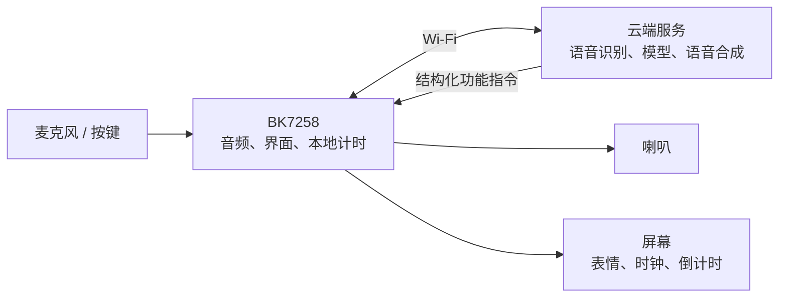

# 初始桌面助手方案（历史）

> 归档日期：2026-11-13。用户尚未回答偏好时的建议；现已由电脑联动方案更新。
> 以下保留当时答复；本机文件链接对应的仓库资料见 [资料索引](../SOURCES.md)。

建议第一版做成一个 **“会说话、有表情、能计时的桌面小助手”**：BK7258 负责声音、屏幕和设备控制，云端负责理解问题和生成回答。先做单屏、USB 供电的样机，跑通后再完善外壳和功能。

结合你项目里的资料，推荐走 **立创 BK7258 硬件＋博通集成的小智参考工程＋LVGL 界面** 这条路线。官方已有语音交互、联网配网和 MCP 工具调用基础，可以在上面扩展桌面功能。[小智参考工程](https://gitee.com/bekencorp/smp_ai_xiaozhi)

**第一版可以实现这些功能：**

| 功能 | 实际使用效果 | 实现位置 |
|---|---|---|
| 语音聊天 | 按键开始说话，助手语音回答，屏幕显示交互状态 | 设备＋云端 |
| 屏幕表情 | 待机、倾听、思考、说话时显示不同表情 | 本地 |
| 桌面时钟 | 显示时间、日期和联网状态 | 本地显示，联网校时 |
| 番茄钟、倒计时 | 说“帮我计时25分钟”，屏幕开始倒计时，到点响铃 | 云端理解，本地执行 |
| 音量、亮度控制 | 按键调整，也可以通过语音调整 | 本地执行 |
| 基础断网使用 | 断网后仍能显示界面、继续已开始的倒计时 | 本地 |

其中，**番茄钟和设备控制值得优先做**，因为它们能让助手真正完成事情。例如“帮我计时25分钟”，处理流程是：云端识别意图 → 下发结构化指令 → BK7258 启动计时器 → 返回执行结果 → 助手确认“已开始计时”。

硬件可以尽量复用你资料中的搭配：

| 部件 | 建议选择 | 原因 |
|---|---|---|
| 主控 | 现有立创 BK7258 模组 | 负责联网、音频、界面和本地任务 |
| 屏幕 | ST7789V2，240×320，横屏使用为320×240 | 本地已有对应显示和 LVGL 示例 |
| 麦克风 | 参考电路中的模拟麦克风方案 | 可以复用音频采集方案 |
| 声音输出 | 芯片音频 DAC＋MS8002 系列功放＋匹配喇叭 | 本地已有播放和麦克风回环示例 |
| 按键 | 一个交互键，另配音量键或旋钮 | 完成唤起、打断和音量调整 |
| 供电 | USB 5V 输入底板，由底板稳压供电 | 适合长期放在桌面使用 |
| 触摸 | 可选 FT6336 触摸屏 | 后续用于切换页面、设置计时 |

USB 的5V应进入底板供电电路，模组按参考设计使用稳压后的电源。第一阶段先用参考扩展板完成样机，再做专用底板和外壳。[官方硬件说明](https://wiki.lckfb.com/zh-hans/bk7258md/bk7258-mod/hardware.html)

整体结构可以这样理解：

大模型放在云端运行。BK7258 保留本地计时、按键响应、界面和设备设置，这样网络出问题时，屏幕和已开始的计时仍然能正常工作。时钟首次使用需要联网校时，断电后的时间恢复也要纳入设计。

软件方面，有三个适配点需要提前安排：

- **补齐开发工程。** 你当前目录以资料和示例为主，`Firmware`、`Hardware` 还是空的；`demo.zip` 依赖完整 SDK 和公共组件。先按官方教程搭建 Ubuntu 开发环境，固定匹配的 SDK 版本，再编译示例。[开发环境教程](https://wiki.lckfb.com/zh-hans/bk7258md/basic/programming-environment-setup.html)
- **适配实际模组和外设。** 小智参考工程默认面向博通集成的参考板，屏幕、音频引脚和内存配置都需要调整。立创文档中的模组配有16MiB PSRAM，Flash 容量还需确认后再确定分区和升级空间。[内存配置说明](https://wiki.lckfb.com/zh-hans/bk7258md/advanced-guide/ram-regions.html)
- **先用按键唤起和打断。** 官方参考工程的离线唤醒方案涉及 KWS 授权。后续加“你好小智”和免按键对话时，再一起处理授权、回声消除以及麦克风与喇叭的结构布局。[小智功能与授权说明](https://gitee.com/bekencorp/smp_ai_xiaozhi/blob/main/README.zh.md)

开发按四步推进，每一步都有明确结果：

1. **把硬件逐项跑通。**  
   验证烧录、Wi-Fi、屏幕、按键、麦克风录音和喇叭播放。先确认声音清楚、供电稳定、屏幕正常。

2. **完成一次完整语音对话。**  
   移植小智工程，完成配网、设备激活、录音上传和语音播放；加入按键打断，并清除被打断回答的剩余音频。

3. **加入桌面交互。**  
   用 LVGL 做“待机时钟—倾听—思考—说话—计时”几个页面。接入计时、音量、亮度三个工具，设备执行成功后再反馈结果。

4. **验证稳定性并做外壳。**  
   检查连续对话、反复打断、断网重连、计时不中断，以及长时间运行；稳定后确定扬声器开孔、麦克风位置、屏幕倾角和底板尺寸。

后续可以按兴趣选择扩展方向：

- **桌面陪伴：** 增加表情、动作动画、语音唤醒和偏好记忆。
- **效率工具：** 增加本地提醒、多个计时器，以及连接电脑服务的待办管理。
- **电脑联动：** 在电脑上运行配套服务，显示电脑状态、控制媒体播放、触发预设操作。
- **摄像头互动：** 增加拍照识物；你已有摄像头预览示例，但云端视觉对话还需要另外集成。

我建议把第一版验收目标定为：**插电后显示时钟，按键即可聊天，能通过语音启动番茄钟，能够随时打断回答，断网后计时继续。** 这个范围与现有资料匹配，也足够做出一个日常能用的桌面助手。
