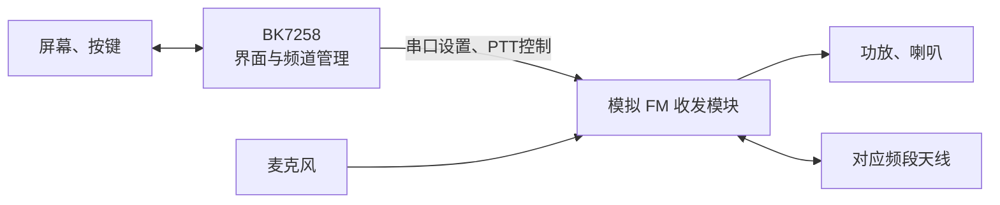

# UV-K1 手台功能对照（历史方向）

> 归档日期：2026-11-13。用户后续选择 AI 桌面助手，手台资料仅作历史参考。
> 以下保留当时答复；本机文件链接对应的仓库资料见 [资料索引](../SOURCES.md)。

**以 BK7258 为主控，可以复现这台 UV-K1 的界面、频道管理和部分音频功能；再外接合适的模拟 FM 收发模块，就可以做出一台能与你现有手台通话的简化设备。**

我逐页看完了 :codex-file-citation{path="C:/Users/Shan_/Downloads/UV-K1-2中文说明书.pdf" purpose="source"}。它包含 200 个信道、双守候、扫描、CTCSS/DCS 亚音、DTMF、VOX、频差设置等功能。技术参数页列出的发射频段为 144–148 MHz、430–440 MHz，功率 ≤5 W；宣传中的“50–600 MHz”主要指接收范围。

对照这些功能，可以这样划分：

| UV-K1 的功能 | 用 BK7258 实现的可行性 | 需要什么 |
|---|---|---|
| **频率/信道双行显示、菜单、中文名称、开机图片** | 适合作为第一批功能 | 屏幕、按键，使用现有 LVGL 示例开发 |
| **200 个信道、保存/删除、扫描列表、参数记忆** | 软件上可实现 | 自行设计配置存储；频道容量不是主要难点 |
| **语音报号、按键音、结束提示音、背光与键盘锁** | 可实现 | 音频输出、功放和喇叭，以及相应程序 |
| **PTT 按住说话、发射限时 TOT、VOX 声控** | 控制逻辑可实现 | 真正发射需外接射频模块；VOX 还需采音和触发算法 |
| **DTMF 拨号、1750 Hz 提示信号** | 可生成音频；接收解码需要开发 | 音频接口；通过无线发送时接入收发模块 |
| **与你的 UV-K1 进行 FM 语音通话** | **可行，是最有价值的目标** | 对应频段的模拟 FM 收发模块、天线、麦克风和音频外围 |
| **亚音、静噪、宽窄带、收发频差、功率选择** | 主要由外接收发模块实现，BK 负责设置 | 模块必须支持这些参数；档位和亚音表未必与 UV-K1 完全相同 |
| **信道扫描、双守候** | 可以设计，但效果取决于射频接口 | 需要切频和接收状态反馈；单接收链路轮询两个频道，不等于同时接收 |
| **宽频接收、航空 AM、一键对频、频率计** | 需要另外选择射频硬件，难度明显更高 | 普通单频段 FM 模块不足以覆盖这些功能 |
| **兼容原机无线复制、原厂写频软件、10 组扰频** | 目前资料不足以确认 | 需要通信协议或算法资料，不能只复制菜单 |

这里的可行性是方案判断，还没有在 BK7258 上完成这些功能的实现和实测。

**我建议第一版做成“带屏、可存信道的单频段 FM 对讲机”。** 架构可以很清楚：

通话音频先直接经过收发模块，BK7258 负责界面、参数和控制。这样可以先把真正的通话做出来，后续再增加录音、语音提示和 Wi-Fi 配置。

我查到的 **SA818S 这类串口控制模块**，已经集成射频收发、功放和部分音频处理，支持独立设置收发频率、CTCSS/DCS、静噪及 12.5/25 kHz 带宽。它有不同频段版本，标称功率为 0.5/1 W，适合作为方案参考；不能据此期待达到 UV-K1 的全部频段和功率指标。[厂商资料](https://www.nicerf.com/walkie-talkie-module/1w-embedded-walkie-talkie-module-sa818s.html)

第一版可以定为这六项：

1. 屏幕显示频率、信道名称和收发状态。
2. 按键切换信道，保存常用配置。
3. 按住 PTT 发话，松开接收。
4. 设置双方共同支持的亚音、静噪和带宽。
5. 加入发射超时保护、音量控制和电量显示。
6. 在双方频率、带宽、亚音设置匹配，并关闭扰频的条件下，验证与 UV-K1 双向通话。

两个压缩包对开发的帮助有限：

- :codex-file-citation{path="C:/Users/Shan_/Downloads/UV-K1(8)固件.rar" purpose="source"} 中只有 `k1_v7.02.02_publish(1).bin`，没有源码，不能直接移植到 BK7258。
- :codex-file-citation{path="C:/Users/Shan_/Downloads/UV-K1(8)写频软件.rar" purpose="source"} 中只有 `QSPortableStationCPS_Setup.exe` 安装程序，没有附带协议说明。它也不能证明原机支持运行中实时改频或完整遥控。

如果你更想保留现有 UV-K1、给它增加功能，另一个可行方向是 **BK7258 录音附件或 Wi-Fi 网络手咪**。这需要先确认手台耳麦口的音频/PTT 接线与电平；远程改频则还要另行确认控制协议。
