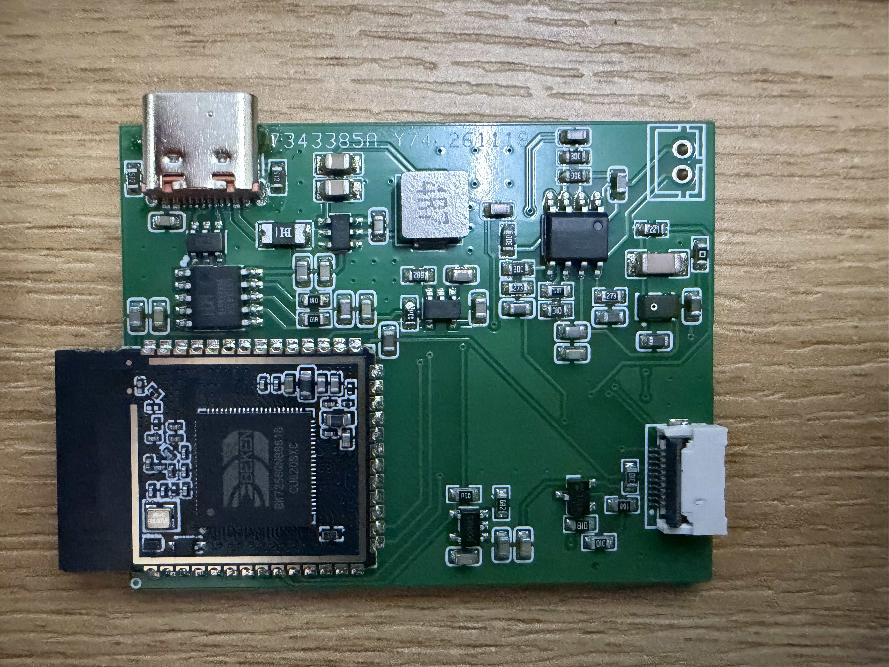
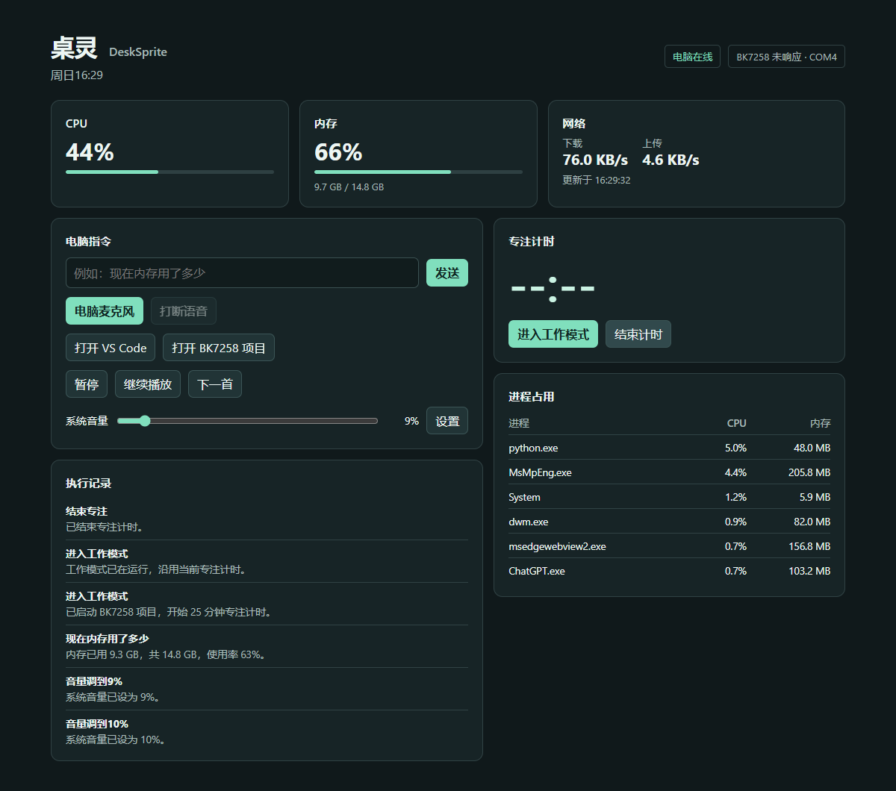
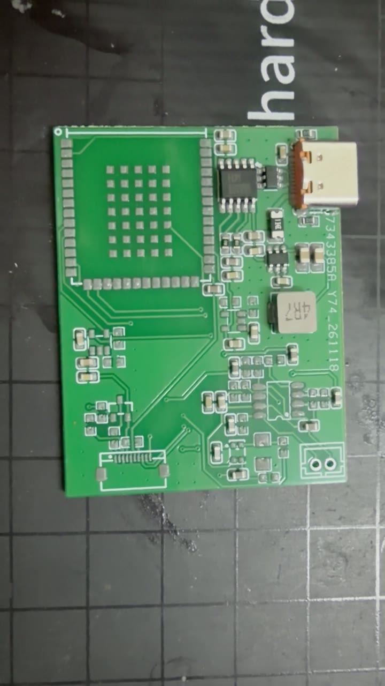
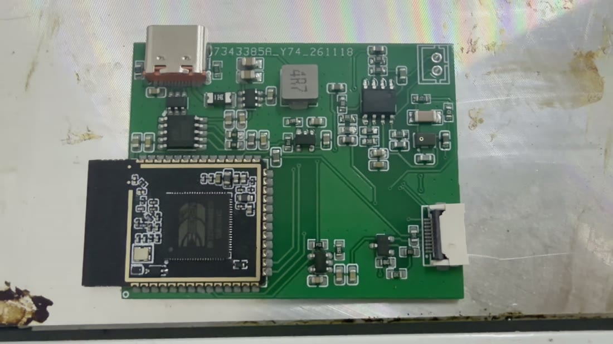
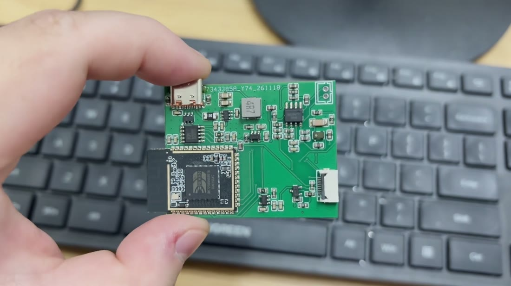

# 桌灵 DeskSprite 项目结项说明

2026 年 11 月 23 日

桌灵是一台基于 BK7258 的 Windows 桌面语音控制终端。自制主板通过 USB-C 连接电脑，板载麦克风负责采音，上位机负责在本机识别中文指令、显示电脑状态并执行操作。实体 LCD 在样机测试中未点亮，项目以 Windows 上位机完成交付。

*图 1　焊装后的样机。左上为 USB-C 接口，右下为屏幕排线插座。*

## 已实现功能

- 监看 CPU、内存、网络上下行速度及占用较高的进程。可发文字指令，也可通过电脑麦克风或板载麦克风查询。
- 设置系统音量、控制当前媒体会话，打开配置好的应用和项目。面板保存近期执行结果，语音答复由 Windows 播放。
- 进入工作模式可打开预设项目并开始 25 分钟专注计时。计时和应用组合可配置，重复触发沿用当前计时。

*图 2　Windows 面板与执行记录。截图时使用电脑麦克风模式。*

## 实物与联调

实板已通过 USB 串口完成烧录并上传一段 4 秒的录音，共 32,000 个采样点。板端格式的语音样本通过 Windows 中文识别，成功执行内存查询。音量调整并回读、媒体暂停与继续，以及专注计时在断线期间继续运行均已验证。

*图 3　模组安装前的底板。*

*图 4　装上模组后的主板。*

*图 5　手持焊装完成的主板。*

## 硬件参数

| 项目 | 设计参数 |
| --- | --- |
| 主控 | LC-OPEN-BK7258-MOD |
| 供电 | USB-C 5 V 输入，AP63203WU-7 降压至 3.3 V |
| 下载与通信 | CH340K 转 UART0，115200 8N1 |
| 采音 | ZTS6216 模拟麦克风，串口上传 8 kHz 单声道 PCM |
| 播放 | MS8002D 差分功放，3.3 V，扬声器选型为 8 Ω、至少 1 W |
| LCD | D200N2407V0，2.0 英寸 IPS，240 × 320，ST7789V2 四线 SPI |
| 屏幕连接器 | AFC34-S10FIA-00，10 针、0.5 mm 间距，适配约 0.30 mm 厚 FPC |
| 工程 | 五页原理图，62 个实体器件，51 个网络，归档最新 PCB 与拼板文件 |

J2 排线需同时匹配 1 脚位置和插座触点。LCD 背光的电气条件尚待实测。最新 PCB 的六条屏幕和功放控制网已与修订原理图的 U1 焊盘分配核对，固件中的旧版 LCD 测试入口尚待适配。[硬件归档](../Hardware/README.md)

## 使用与复现

Windows 11 安装 uv 后，从仓库根目录运行 `uv run --directory Desktop --locked python app.py`，或双击 `Desktop/start.cmd`。面板支持文字和电脑麦克风。实板按固件文档构建并烧录后，可修改实际 COM 号并使用「板载麦克风」。

[Windows 上位机](../Desktop/README.md) · [固件构建](../Firmware/voice-bringup/README.md) · [结项记录](PROJECT_PLAN.md) · [立创开源工程](https://oshwhub.com/smallcoral/project_fwqytqsw)
